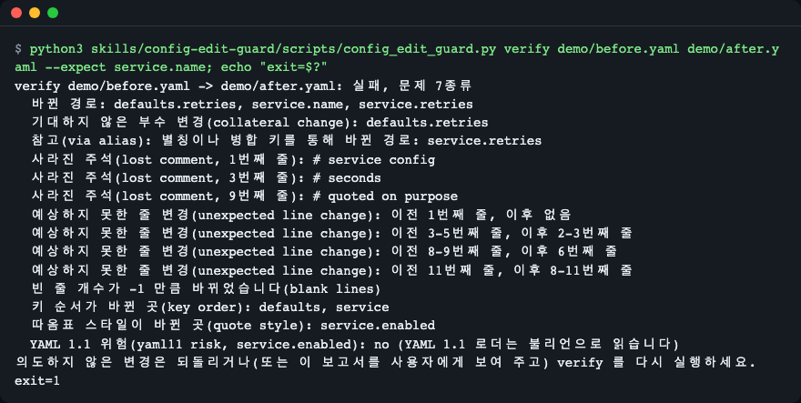
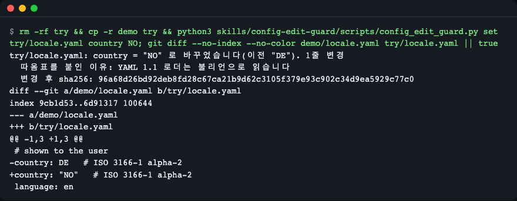
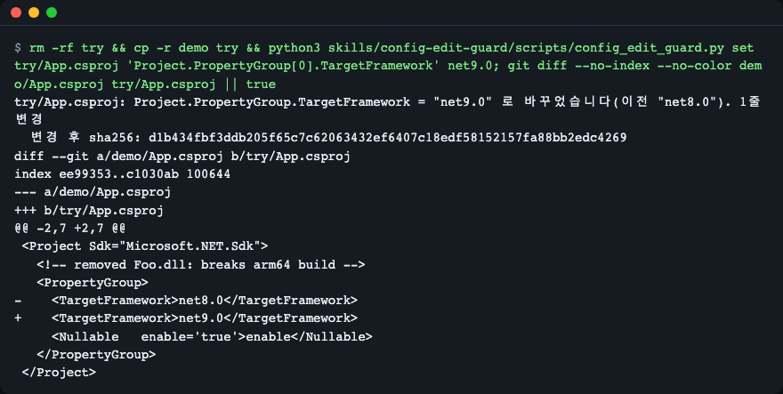
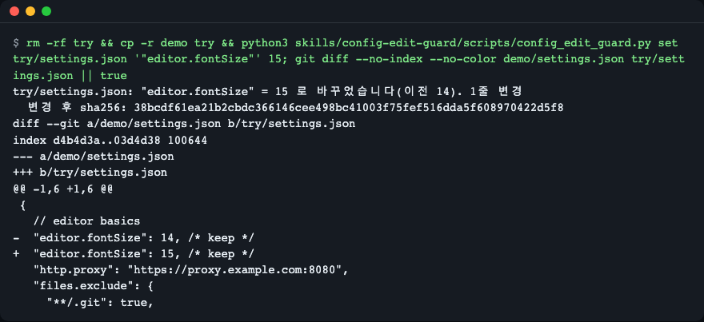
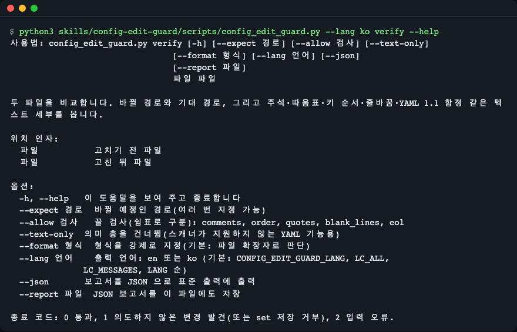

# config-edit-guard

[English](README.md) | **한국어**

코딩 에이전트가 설정 파일의 값 하나를 바꿀 때 그 값의 바이트 범위만 교체하게 하고, 편집 전후 파일을 두 층에서 비교해 의도하지 않은 변경을 리뷰 작업 대신 종료 코드로 알려 주는 에이전트 스킬입니다. Claude Code 와 Agent Skills 형식(`SKILL.md` + 스크립트)을 읽는 다른 에이전트에서 쓸 수 있고, 파이썬 표준 라이브러리만 쓰며, YAML·JSON/JSONC·TOML·XML(`.csproj`, `pom.xml`)·마크다운 앞머리(front matter)를 다룹니다.



*에이전트가 파일 전체를 다시 쓴 경우: `verify` 가 기대한 변경 하나와 부수 피해를 가르고 종료 코드 1 을 냅니다. `demo/` 의 "after" 파일은 그런 재작성을 사람이 만든 예시입니다.*

## 왜 필요한가

에이전트에게 "이미지 태그만 올려 줘"라고 하면 파일 전체를 다시 쓰는 일이 생깁니다. diff 를 눈으로 읽어서는 무엇이 잘못됐는지 믿을 만하게 잡아내지 못합니다.

- **주석과 서식이 사라집니다.** JSON·YAML 라이브러리로 파일을 다시 쓰면 주석이 없어지고, 따옴표·들여쓰기가 바뀌고, 아무도 고치라고 하지 않은 줄이 다시 직렬화됩니다. 예: 덮어쓰기에서 블록 주석이 사라진 MCP 설정([claude-code #69354](https://github.com/anthropics/claude-code/issues/69354)), 서식이 바뀐 `.csproj`([claude-code #63356](https://github.com/anthropics/claude-code/issues/63356)), 다시 직렬화되며 `#` 뒤가 잘린 앞머리([claude-code #61099](https://github.com/anthropics/claude-code/issues/61099)).
- **"의미가 같다"와 "바이트가 같다"는 다릅니다.** YAML 1.1 로더는 `NO` 를 `false` 로, `0755` 를 8진수로, `1.10` 을 `1.1` 로 읽습니다([pyyaml #116](https://github.com/yaml/pyyaml/issues/116)). 다시 쓰다가 떨어진 따옴표 하나가 문자열을 불리언으로 바꿀 수 있습니다.
- **한 번의 편집이 설정 두 개를 바꿀 수 있습니다.** 앵커가 붙은 값을 고치면 `<<: *defaults` 로 병합한 모든 설정이 함께 바뀝니다. 이것과 진짜 엉뚱한 편집을 가르려면 눈이 아니라 집합 비교가 필요합니다.

라운드트립 라이브러리(ruamel.yaml, tomlkit)와 `yq`·`dasel` CLI 는 첫 번째 문제를 줄여 주지만 파일을 다시 직렬화하므로 바이트 보존을 약속하지 않습니다. 이 스킬을 만들며 쓴 프로브 파일에서는 4칸 들여쓰기 YAML 이 ruamel.yaml 의 무변경 왕복 뒤에도 들여쓰기가 달라졌고, ElementTree 는 XML 선언과 아무도 건드리지 않은 속성의 따옴표를 다시 썼습니다.

## 하는 일

스킬에는 스크립트 하나(`skills/config-edit-guard/scripts/config_edit_guard.py`)와 명령 셋이 들어 있습니다.

| 명령 | 하는 일 |
|---|---|
| `locate FILE PATH` | 값, 타입, 따옴표 스타일, 정확한 바이트 범위·줄·열을 출력합니다. 섹션이면 아래 키를 나열합니다. |
| `set FILE PATH VALUE` | 값의 바이트 범위만 교체합니다. 원래 따옴표 스타일·줄 끝·BOM 을 유지하고, YAML 1.1 이 잘못 읽을 값에는 따옴표를 붙입니다. 결과를 메모리에서 지정한 경로 기준으로 검사하고 통과해야만 저장합니다. |
| `verify BEFORE AFTER --expect PATH` | 두 파일을 비교합니다. 의미 층: 어떤 경로가 바뀌었는지, 무엇이 기대됐는지, 무엇이 별칭을 통해서만 바뀌었는지. 텍스트 층: 주석, 줄, 빈 줄, 따옴표, 키 순서, 줄 끝, 마지막 줄바꿈, BOM, 앵커, 중복 키, YAML 1.1 함정. 의도하지 않은 변경이 없으면 종료 코드 0, 있으면 1 입니다. |

`SKILL.md` 가 어떤 요청에 어떤 명령을 쓸지 에이전트에게 알려 주므로 보통은 직접 입력할 일이 없습니다([에이전트 없이 스크립트만 쓰기](#에이전트-없이-스크립트만-쓰기) 참고).

## 설치

파이썬 3.10 이상이 필요합니다(TOML 은 3.11 이상). 파이썬은 패키지 관리자로 설치하세요. 예: `brew install python`, `sudo apt-get install python3`. 그 밖에는 필요 없습니다. 스크립트는 외부 의존성과 네트워크 접근이 없습니다.

**Claude Code** (플러그인 마켓플레이스, 이 저장소를 GitHub 에 공개한 뒤 쓸 수 있습니다):

```text
/plugin marketplace add LeeGyeongPil/config-edit-guard
/plugin install config-edit-guard@config-edit-guard-skill
```

**폴더 복사** (오프라인에서도 되며, Claude Code 개인 스킬용):

```bash
git clone https://github.com/LeeGyeongPil/config-edit-guard.git
mkdir -p ~/.claude/skills
cp -r config-edit-guard/skills/config-edit-guard ~/.claude/skills/
```

한 프로젝트에서만 쓰려면 그 프로젝트의 `.claude/skills/` 로 복사하세요.

**Agent Skills 형식을 읽는 다른 에이전트**: 같은 `skills/config-edit-guard` 폴더를 그 에이전트의 스킬 폴더에 복사하세요.

**Codex CLI** (`codex-cli 0.154.0` 에서 확인): 프로젝트의 `.agents/skills/` 에 폴더를 복사하세요.

```bash
mkdir -p .agents/skills
cp -r config-edit-guard/skills/config-edit-guard .agents/skills/
```

실측 결과(Claude Code, `sonnet`, 케이스마다 3회):

<!-- skill-eval:start -->
| 확인 | 결과 |
|---|---|
| 필요할 때 불림 | 12/12 |
| 필요 없을 때 안 불림 | 10/11 |
| 스킬로 푼 작업 | 6/6 |
| 스킬 없이 푼 작업(기준선) | 0/6 |
| 평균 점수 차이(Δ) | +0.57 |
| 가짜 스크립트를 잡아낸 비율 | 6/6 |
| Codex CLI | 작업 7/7 통과 · 확인됨 |

Claude Code 2.1.322 · sonnet · 케이스마다 3회 · 2026-11-14 측정 · codex-cli 0.154.0
<!-- skill-eval:end -->

## 빠르게 시작하기

이 저장소를 clone 한 폴더에서 실행합니다. `demo/` 에는 작은 샘플 파일이 있고, `try/` 는 샘플이 그대로 남도록 만드는 임시 복사본입니다.

```bash
python3 skills/config-edit-guard/scripts/config_edit_guard.py verify demo/before.yaml demo/after.yaml --expect service.name; echo "exit=$?"
```

파일과, 그 파일을 통째로 다시 쓴 것(부주의한 에이전트 편집을 흉내 내려고 사람이 만든 예시)을 비교합니다. 바뀌어야 했던 것은 `service.name` 뿐입니다. 아래는 영어 출력입니다(한국어 화면은 위 스크린샷과 [언어](#언어) 참고).

```text
verify demo/before.yaml -> demo/after.yaml: FAIL, 7 kind(s) of problem
  changed paths: defaults.retries, service.name, service.retries
  collateral change, not expected: defaults.retries
  info: changed through an alias or merge key: service.retries
  lost comment at line 1: # service config
  lost comment at line 3: # seconds
  lost comment at line 9: # quoted on purpose
  unexpected line change: before line 1, after none
  unexpected line change: before line 3-5, after line 2-3
  unexpected line change: before line 8-9, after line 6
  unexpected line change: before line 11, after line 8-11
  blank line count changed by -1
  key order changed in: defaults, service
  quote style changed at: service.enabled
  YAML 1.1 risk at service.enabled: no (YAML 1.1 loaders read it as a boolean)
Revert the unintended changes (or show this report to the user), then run verify again.
exit=1
```

뜻은 다음과 같습니다.

- `collateral change`(부수 변경)는 진짜 의도하지 않은 변경입니다. `defaults.retries` 는 기대 목록에 없었습니다.
- `info: changed through an alias`(별칭을 통한 변경)는 오류가 아닙니다. `service.retries` 는 `<<: *defaults` 를 통해 `defaults.retries` 를 따라간 것입니다.
- `lost comment`(사라진 주석)에는 줄 번호가 있어 에이전트가 되살릴 수 있습니다.
- 마지막 줄은 다음에 할 일을 알려 줍니다. 종료 코드는 1 입니다.

이제 했어야 할 편집을 `set` 으로 해 봅니다. `country: NO` 는 대표적인 함정이라, 스크립트가 값을 따옴표로 감싸 쓰고 이유를 알려 줍니다.

```bash
rm -rf try && cp -r demo try && python3 skills/config-edit-guard/scripts/config_edit_guard.py set try/locale.yaml country NO; git diff --no-index --no-color demo/locale.yaml try/locale.yaml || true
```



*한 줄만 바뀌었고 뒤의 주석은 그대로이며, YAML 1.1 로더가 따옴표 없는 `NO` 를 `false` 로 읽기 때문에 값에 따옴표가 붙었습니다.*

끝나면 임시 복사본을 지우세요: `rm -rf try`.

## 에이전트가 쓰는 방식

설치하면 "deploy.yaml 의 이미지 태그를 1.4.2 로 바꿔 줘", "replicaCount 말고 바뀐 게 있나 봐 줘" 같은 요청에 에이전트가 스킬을 스스로 고릅니다. `SKILL.md` 의 순서는 다음과 같습니다.

1. **스칼라 값 하나**(문자열·숫자·불리언): 에이전트가 `set FILE PATH VALUE` 를 실행합니다. 값을 손으로 고치거나 라이브러리로 파일을 다시 쓰지 않습니다.
2. **구조 변경**(키·목록 항목 추가·삭제): 파일을 `FILE.orig` 로 복사하고 가장 작은 수동 편집을 한 뒤, 바꾸려던 모든 경로에 대해 `verify FILE.orig FILE --expect PATH` 를 실행합니다.
3. **"다른 것도 바뀌었나?"**: 파일을 먼저 읽지 않고 `verify BEFORE AFTER --expect PATH` 를 실행합니다.
4. **"이 값이 어디 있나?"**: `locate FILE PATH` 를 실행하고 출력의 줄·바이트 오프셋을 그대로 보고합니다.
5. **종료 코드 1 또는 2 뒤**: 결과를 출력된 그대로 보여 주고, 원본을 되돌려 더 작게 고치거나 사용자에게 묻습니다. 그런 변경이 괜찮다고 사용자가 말하지 않았다면 `--allow` 로 지적을 끄지 않습니다.

경로는 키 사이에 점, 목록 항목에 `[0]`, 점이 들어 있는 키에는 큰따옴표를 씁니다: `spec.template.spec.containers[0].image`, `"editor.fontSize"`, `tool.ruff."line-length"`. XML 경로는 루트 요소에서 시작하고 속성은 `@name` 입니다.

값의 위치를 보려면:

```bash
python3 skills/config-edit-guard/scripts/config_edit_guard.py locate demo/before.yaml service.name
```

```text
demo/before.yaml: service.name is a value (str, single)
  value: "api"
  span: bytes 110-115, line 8 column 9 to line 8 column 14
```

## 지원 형식과 한계

| 형식 | `locate` / `set` / `verify` | 비고 |
|---|---|---|
| YAML | 셋 다 | 설정 파일에 쓰이는 부분집합: 블록 매핑·시퀀스, 한 줄 스칼라, 한 줄 `[...]`·`{...}`, 주석, 앵커, 별칭, `<<` 병합 키, 태그, 여러 문서. `set` 은 블록 스칼라(`\|`, `>`)를 다시 쓰지 않습니다. |
| JSON / JSONC | 셋 다 | 주석과 끝 쉼표는 유지되고 문자열 속 `https://` 는 건드리지 않습니다. JSON5 는 지원하지 않습니다. |
| TOML | 셋 다 | 파이썬 3.11 이상 필요(3.10 에서는 `E_PYTHON`). |
| XML | 셋 다 | `.csproj`, `pom.xml` 등. 요소 텍스트와 속성. 엔티티·CDATA·주석이 든 텍스트와 자기 닫힘 요소는 `set` 이 거부합니다. |
| 마크다운 앞머리(front matter) | 셋 다 | 파일 맨 위의 `---` 블록. |

`.env`, INI, HCL 은 범위 밖입니다. 새 파일 만들기, 형식 변환, 스키마 검증, 린트는 이 스킬이 하는 일이 아닙니다.

YAML 스캐너가 읽지 못하는 것(여러 줄 plain·따옴표 스칼라, 여러 줄 flow 컬렉션, 복합 `?` 키)을 만나면 추측하지 않고 `E_UNSUPPORTED` 와 줄·열을 내고 멈춥니다. 해결책은 손으로 고친 뒤 `verify --text-only BEFORE AFTER` 를 실행하는 것입니다. 의미 층은 건너뛰지만 주석·빈 줄·줄 끝은 여전히 검사합니다. 키나 목록 항목 추가·삭제도 자동화하지 않습니다. 에이전트가 손으로 고치고 `verify` 를 실행합니다.

중복 키가 있으면 대상이 모호하므로 `set` 이 거부하고 파일은 그대로 남습니다.

```bash
printf 'server:\n  port: 8080\n  host: a\n  port: 9090\n' > dup.yaml && python3 skills/config-edit-guard/scripts/config_edit_guard.py set dup.yaml server.port 8443
```

```text
config-edit-guard: error [E_AMBIGUOUS_PATH] server.port: key 'port' appears more than once (line 2, line 4) — fix: remove the duplicate first, then run the command again
```

`rm dup.yaml` 로 정리하세요.

다른 형식도 같은 한 줄 편집을 보여 줍니다. `.csproj` 편집은 선언 줄과 간격이 이상한 `<Nullable   enable='true'>` 를 건드리지 않습니다.

```bash
rm -rf try && cp -r demo try && python3 skills/config-edit-guard/scripts/config_edit_guard.py set try/App.csproj 'Project.PropertyGroup[0].TargetFramework' net9.0; git diff --no-index --no-color demo/App.csproj try/App.csproj || true
```



*`.csproj` 한 줄만 바뀌었습니다. 같은 파일을 ElementTree 로 다시 직렬화하면 여러 줄이 바뀌며, 비교는 `tests/test_xml.py` 에 있습니다.*

JSONC 설정 파일은 주석·끝 쉼표·URL 을 그대로 유지합니다.

```bash
rm -rf try && cp -r demo try && python3 skills/config-edit-guard/scripts/config_edit_guard.py set try/settings.json '"editor.fontSize"' 15; git diff --no-index --no-color demo/settings.json try/settings.json || true
```



*값 뒤의 블록 주석, 줄 주석, 끝 쉼표, 프록시 URL 이 그대로입니다.*

## 보고서 필드와 종료 코드

`--json` 을 붙이면 보고서를 JSON 으로 출력하고, `--report FILE.json` 은 파일로도 저장합니다. 키와 `E_*` 코드는 영어·한국어 출력에서 같습니다.

| `verify` 필드 | 뜻 | 종료 코드 1 |
|---|---|---|
| `changed_paths` | 값이 바뀐 모든 경로 | 아니오 |
| `collateral_paths` | 바뀌었지만 기대하지 않았고 별칭으로 설명되지 않는 경로 | 예 |
| `via_alias` | 앵커가 붙은 값이 바뀌어서만 따라 바뀐 경로 | 아니오 |
| `unchanged_expected` | 기대한 경로가 바뀌지 않음 | 예 |
| `lost_comments`, `added_comments` | 줄과 내용으로 본 주석(추가된 것은 정보일 뿐) | 사라진 것: 예 |
| `unexpected_line_changes` | 기대한 경로 밖에서 바뀐 줄 | 예 |
| `blank_line_delta` | 기대한 줄 밖에서 빈 줄이 늘거나 준 정도 | 예 |
| `key_order_changed`, `quote_style_changed` | 키 순서 또는 따옴표가 바뀜 | 예 |
| `yaml11_risky`, `duplicate_keys`, `anchors_lost` | 새 YAML 1.1 함정, 새 중복 키, 사라진 앵커 | 예 |
| `eol_changed`, `final_newline_changed`, `bom_changed` | 줄 끝, 마지막 줄바꿈, BOM | 예 |
| `before_sha256`, `after_sha256` | 두 파일의 해시 | 아니오 |

`--allow comments,order,quotes,blank_lines,eol` 은 이름 붙인 검사만 끕니다. `--text-only` 는 의미 층을 건너뜁니다. `set --type auto|str|int|float|bool|null` 은 값 타입을 정합니다(`auto` 는 기존 타입을 유지하고, 숫자 자리에 숫자가 아닌 값을 쓰면 `E_TYPE` 으로 종료 코드 2 이며 `--type str` 로 덮어씁니다). `set --dry-run` 은 쓰지 않고 검사만 합니다.

| 종료 코드 | 뜻 |
|---|---|
| 0 | 통과(`set` 은 파일 저장) |
| 1 | 의도하지 않은 변경 발견(`verify`) 또는 자기 검증이 저장을 거부(`set`) |
| 2 | 입력 문제. 오류 줄에 코드와 고치는 법이 있고 파일은 바뀌지 않습니다 |

오류 코드: `E_USAGE`, `E_FILE_NOT_FOUND`, `E_ENCODING`, `E_PARSE`, `E_UNSUPPORTED`, `E_PATH_NOT_FOUND`(가장 가까운 키를 제안), `E_AMBIGUOUS_PATH`, `E_NOT_SCALAR`, `E_TYPE`, `E_FORMAT`, `E_PYTHON`. 자세한 목록은 [`skills/config-edit-guard/references/paths-and-formats.md`](skills/config-edit-guard/references/paths-and-formats.md) 에 있습니다.

## 에이전트 없이 스크립트만 쓰기

스크립트는 평범한 명령줄 도구로도 동작합니다. 예를 들어 동료가 손으로 고친 values 파일을 검사합니다(여기서는 본인 파일을 쓰세요).

```bash
python3 skills/config-edit-guard/scripts/config_edit_guard.py verify values.before.yaml values.yaml --expect replicaCount
```

셸 스크립트나 CI 단계에서 쓸 수 있습니다. 종료 코드 0 은 `replicaCount` 말고 바뀐 것이 없다는 뜻이고, 1 은 무언가 찾았다는 뜻입니다. 모든 옵션은 `python3 skills/config-edit-guard/scripts/config_edit_guard.py --help` 와 `... set --help` 로 보세요. 테스트는 `uv sync && uv run pytest -q` 입니다.

## 언어

출력은 영어 또는 한국어입니다. 순서는 `--lang en|ko`, `CONFIG_EDIT_GUARD_LANG` 환경 변수, `LC_ALL`, `LC_MESSAGES`, `LANG` 이며, 값이 있는 첫 번째가 정하고 `ko` 로 시작하지 않으면 영어입니다. 도움말, argparse 라벨, 오류 메시지는 번역되고 JSON 키와 `E_*` 코드는 번역되지 않습니다.

```bash
python3 skills/config-edit-guard/scripts/config_edit_guard.py --lang ko verify --help
```



*같은 명령에 `--lang en` 을 주면 영어 도움말이 나옵니다.*

## 평가

저장소의 `evals/` 에는 평가 세트(발동 케이스, 발동하면 안 되는 근접·원거리 케이스, 픽스처 파일이 있는 작업 케이스)와 테스트가 있습니다. 실측 표는 위 설치 절에 있습니다. 발동 케이스 12개 모두 발동했고, 발동하면 안 되는 케이스 11개 중 1개(yamllint 들여쓰기 수정 요청)가 발동했으며, 스킬을 쓴 작업은 6개 중 6개 통과, 스킬 없이는 6개 중 0개 통과, Codex CLI 작업 케이스 7개는 모두 통과했습니다(`sonnet`, 케이스마다 3회, 2026-11-14). 케이스는 작고 이 스킬에 맞춰 쓴 것이라 벤치마크가 아니라 스모크 테스트로 보세요.

## 대안

- YAML·JSON 의 읽기 쉬운 의미 diff 는 [dyff](https://github.com/homeport/dyff).
- 명령줄에서 여러 형식을 조회·편집하려면 [yq](https://github.com/mikefarah/yq), [dasel](https://github.com/TomWright/dasel).
- 파이썬 코드에서 라운드트립 편집을 하려면 [ruamel.yaml](https://pypi.org/project/ruamel.yaml/), [tomlkit](https://github.com/python-poetry/tomlkit).

무엇을 지원하는지는 각 공식 문서를 보세요. 이 스킬은 에이전트가 값 하나를 바꾸고 그 결과를 종료 코드로 판정받고 싶은 좁은 경우를 위한 것입니다.

## 라이선스

MIT, [LICENSE](LICENSE) 참고.
