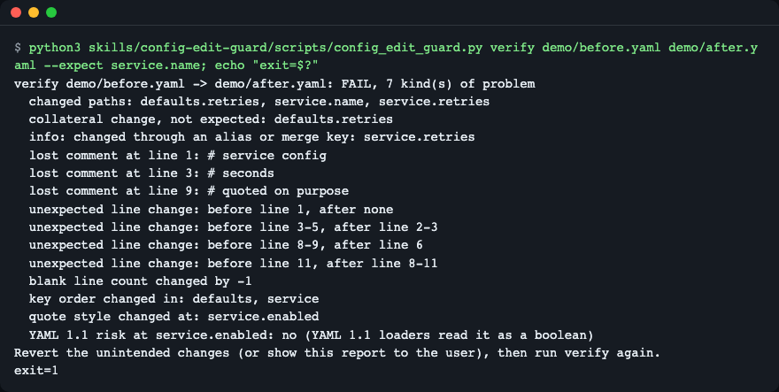
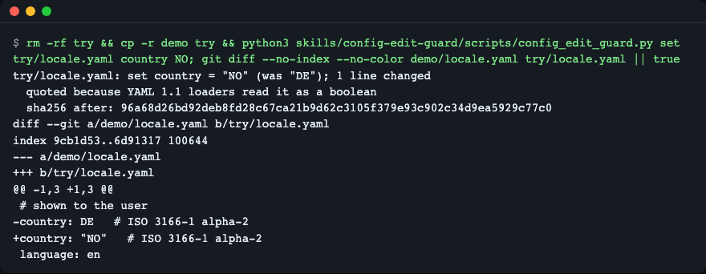
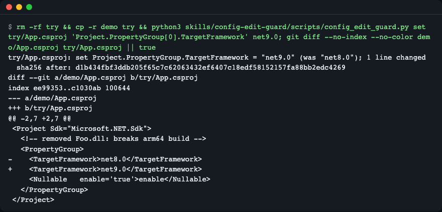
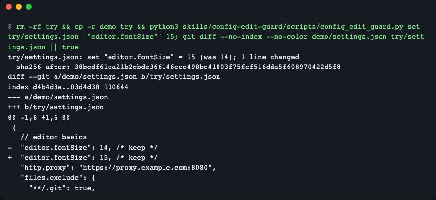
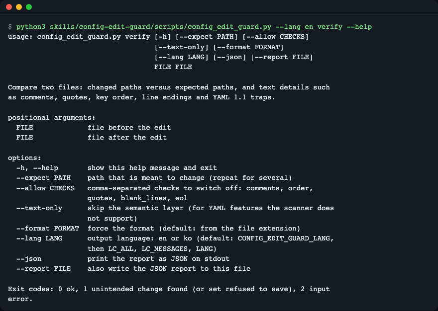

# config-edit-guard

**English** | [한국어](README.ko.md)

An agent skill that lets a coding agent change one value in a config file by replacing only that value's bytes, then checks the before and after files on two layers so that unintended changes become an exit code instead of a review chore. It works with Claude Code and other agents that read the Agent Skills format (`SKILL.md` plus scripts), uses only the Python standard library, and covers YAML, JSON/JSONC, TOML, XML (`.csproj`, `pom.xml`) and Markdown front matter.



*A file that an agent rewrote as a whole: `verify` sorts out the one expected change from the collateral damage and exits with 1. The "after" file in `demo/` is a hand-made example of such a rewrite.*

## Why

Ask an agent to "bump the image tag" and it may rewrite the whole file. Reading the diff by eye does not reliably catch what went wrong:

- **Comments and layout vanish.** Writing a config back through a JSON or YAML library drops comments, changes quotes and indentation, and re-serializes lines nobody asked about. Examples: an MCP config whose block comments were lost on overwrite ([claude-code #69354](https://github.com/anthropics/claude-code/issues/69354)), a `.csproj` that was reformatted ([claude-code #63356](https://github.com/anthropics/claude-code/issues/63356)), front matter that was re-serialized and cut at `#` ([claude-code #61099](https://github.com/anthropics/claude-code/issues/61099)).
- **"Same meaning" is not "same bytes".** YAML 1.1 loaders read `NO` as `false`, `0755` as an octal number and `1.10` as `1.1` ([pyyaml #116](https://github.com/yaml/pyyaml/issues/116)). A quote that was removed during a rewrite can change a string into a boolean.
- **One edit can change two settings.** Editing an anchored value changes every setting that merges it with `<<: *defaults`. Telling that apart from a real stray edit takes a set comparison, not a glance.

Round-trip libraries (ruamel.yaml, tomlkit) and the `yq` and `dasel` CLIs narrow the first problem but re-serialize the file, so they do not promise to keep the bytes. On the probe files used while building this skill, a 4-space-indented YAML file came back with different indentation after a no-change round trip through ruamel.yaml, and ElementTree rewrote the quotes of an XML declaration and of an attribute nobody touched.

## What it does

The skill bundles one script, `skills/config-edit-guard/scripts/config_edit_guard.py`, with three commands:

| Command | What it does |
|---|---|
| `locate FILE PATH` | Prints the value, its type and quote style, and its exact byte span, line and column. For a section it lists the child keys. |
| `set FILE PATH VALUE` | Replaces only the value's byte span. Keeps the original quote style, line endings and BOM. Quotes the new value when YAML 1.1 would misread it. Checks the result in memory against the path you named and saves only if the check passes. |
| `verify BEFORE AFTER --expect PATH` | Compares two files. Semantic layer: which paths changed, which were expected, which changed only through an alias. Text layer: comments, lines, blank lines, quotes, key order, line endings, final newline, BOM, anchors, duplicate keys, YAML 1.1 traps. Exit 0 when nothing unintended changed, 1 otherwise. |

`SKILL.md` tells the agent which command to use for which request, so you normally never type these yourself (see [Using the script without an agent](#using-the-script-without-an-agent)).

## Install

Requires Python 3.10 or newer (TOML needs 3.11 or newer). Install Python with your package manager, for example `brew install python` or `sudo apt-get install python3`. Nothing else is needed; the script has no third-party dependencies and no network access.

**Claude Code** (plugin marketplace; usable once this repository is published on GitHub):

```text
/plugin marketplace add LeeGyeongPil/config-edit-guard
/plugin install config-edit-guard@config-edit-guard-skill
```

**Copy the folder** (works offline; for Claude Code personal skills):

```bash
git clone https://github.com/LeeGyeongPil/config-edit-guard.git
mkdir -p ~/.claude/skills
cp -r config-edit-guard/skills/config-edit-guard ~/.claude/skills/
```

For a single project, copy it to `.claude/skills/` inside that project instead.

**Other agents that read the Agent Skills format**: copy the same `skills/config-edit-guard` folder into that agent's skills folder.

**Codex CLI** (checked with `codex-cli 0.154.0`): copy the folder into `.agents/skills/` of your project.

```bash
mkdir -p .agents/skills
cp -r config-edit-guard/skills/config-edit-guard .agents/skills/
```

Measured results (Claude Code, `sonnet`, 3 runs per case):

<!-- skill-eval:start -->
| Check | Result |
|---|---|
| Triggers when it should | 12/12 |
| Stays quiet when it should not | 10/11 |
| Tasks solved with the skill | 6/6 |
| Tasks solved without it (baseline) | 0/6 |
| Mean score gain (Δ) | +0.57 |
| Tasks that catch a broken script | 6/6 |
| Codex CLI | 7/7 tasks · verified |

Measured 2026-11-14 with Claude Code 2.1.322 · sonnet · 3 runs per case · codex-cli 0.154.0
<!-- skill-eval:end -->

## Quick start

Run these from a clone of this repository. The `demo/` folder has small sample files; `try/` is a scratch copy so the samples stay as they are.

```bash
python3 skills/config-edit-guard/scripts/config_edit_guard.py verify demo/before.yaml demo/after.yaml --expect service.name; echo "exit=$?"
```

This compares a file with a whole-file rewrite of itself (a hand-made example of what a careless agent edit looks like). Only `service.name` was supposed to change.

```text
verify demo/before.yaml -> demo/after.yaml: FAIL, 7 kind(s) of problem
  changed paths: defaults.retries, service.name, service.retries
  collateral change, not expected: defaults.retries
  info: changed through an alias or merge key: service.retries
  lost comment at line 1: # service config
  lost comment at line 3: # seconds
  lost comment at line 9: # quoted on purpose
  unexpected line change: before line 1, after none
  unexpected line change: before line 3-5, after line 2-3
  unexpected line change: before line 8-9, after line 6
  unexpected line change: before line 11, after line 8-11
  blank line count changed by -1
  key order changed in: defaults, service
  quote style changed at: service.enabled
  YAML 1.1 risk at service.enabled: no (YAML 1.1 loaders read it as a boolean)
Revert the unintended changes (or show this report to the user), then run verify again.
exit=1
```

What it means:

- `collateral change` is a real unintended change: `defaults.retries` was not on the expected list.
- `info: changed through an alias` is not an error: `service.retries` follows `defaults.retries` through `<<: *defaults`.
- The `lost comment` lines carry line numbers, so the agent can restore them.
- The last line says what to do next. The exit code is 1.

Now the edit that should have been made, with `set`. `country: NO` is the classic trap, so the script writes the value with quotes and says why:

```bash
rm -rf try && cp -r demo try && python3 skills/config-edit-guard/scripts/config_edit_guard.py set try/locale.yaml country NO; git diff --no-index --no-color demo/locale.yaml try/locale.yaml || true
```



*One line changed, the trailing comment survived, and the value is quoted because YAML 1.1 loaders read plain `NO` as `false`.*

Delete the scratch copy when you are done: `rm -rf try`.

## How the agent uses it

Once installed, the agent picks the skill by itself when you ask for something like "set the image tag to 1.4.2 in deploy.yaml" or "did my edit change anything besides replicaCount?". The steps in `SKILL.md`:

1. **One scalar value** (string, number, boolean): the agent runs `set FILE PATH VALUE`. It does not edit the value by hand or rewrite the file with a library.
2. **A structural change** (add or remove a key or list item): the agent copies the file to `FILE.orig`, makes the smallest hand edit, then runs `verify FILE.orig FILE --expect PATH` for every path it meant to change.
3. **"Did this change anything else?"**: the agent runs `verify BEFORE AFTER --expect PATH` without reading the files first.
4. **"Where is this value?"**: the agent runs `locate FILE PATH` and reports the line and byte offset from its output.
5. **After exit 1 or 2**: the agent shows the findings as printed, restores the original and tries a smaller edit, or asks you. It does not silence a finding with `--allow` unless you said that kind of change is fine.

Paths use dots between keys, `[0]` for list items and double quotes around keys that contain dots: `spec.template.spec.containers[0].image`, `"editor.fontSize"`, `tool.ruff."line-length"`. XML paths start at the root element and use `@name` for attributes.

To see where a value sits:

```bash
python3 skills/config-edit-guard/scripts/config_edit_guard.py locate demo/before.yaml service.name
```

```text
demo/before.yaml: service.name is a value (str, single)
  value: "api"
  span: bytes 110-115, line 8 column 9 to line 8 column 14
```

## Formats & limits

| Format | `locate` / `set` / `verify` | Notes |
|---|---|---|
| YAML | all three | A subset used by config files: block mappings and sequences, single-line scalars, single-line `[...]` and `{...}`, comments, anchors, aliases, `<<` merge keys, tags, several documents. `set` does not rewrite block scalars (`\|`, `>`). |
| JSON / JSONC | all three | Comments and trailing commas are kept; `https://` inside strings is left alone. JSON5 is not supported. |
| TOML | all three | Needs Python 3.11 or newer (`E_PYTHON` on 3.10). |
| XML | all three | `.csproj`, `pom.xml` and similar. Element text and attributes. `set` refuses text with entities, CDATA or comments, and self-closing elements. |
| Markdown front matter | all three | The `---` block at the top of the file. |

`.env`, INI and HCL are out of scope. Creating files, converting formats, schema validation and linting are not what this skill does.

When the YAML scanner meets something it does not read (multi-line plain or quoted scalars, multi-line flow collections, complex `?` keys), it stops with `E_UNSUPPORTED` and the line and column instead of guessing. The way out is to edit by hand and run `verify --text-only BEFORE AFTER`, which skips the semantic layer and still checks comments, blank lines and line endings. Adding or removing keys and list items is not automated either; the agent edits by hand and runs `verify`.

A duplicate key makes the target ambiguous, so `set` refuses and the file stays untouched:

```bash
printf 'server:\n  port: 8080\n  host: a\n  port: 9090\n' > dup.yaml && python3 skills/config-edit-guard/scripts/config_edit_guard.py set dup.yaml server.port 8443
```

```text
config-edit-guard: error [E_AMBIGUOUS_PATH] server.port: key 'port' appears more than once (line 2, line 4) — fix: remove the duplicate first, then run the command again
```

Clean up with `rm dup.yaml`.

More formats show the same one-line behaviour. A `.csproj` edit leaves the declaration and the oddly spaced `<Nullable   enable='true'>` alone:

```bash
rm -rf try && cp -r demo try && python3 skills/config-edit-guard/scripts/config_edit_guard.py set try/App.csproj 'Project.PropertyGroup[0].TargetFramework' net9.0; git diff --no-index --no-color demo/App.csproj try/App.csproj || true
```



*One line of the `.csproj` changed. Re-serializing the same file with ElementTree changes several lines; `tests/test_xml.py` shows the comparison.*

A JSONC settings file keeps its comments, trailing commas and URL:

```bash
rm -rf try && cp -r demo try && python3 skills/config-edit-guard/scripts/config_edit_guard.py set try/settings.json '"editor.fontSize"' 15; git diff --no-index --no-color demo/settings.json try/settings.json || true
```



*The block comment after the value, the line comment, the trailing commas and the proxy URL are untouched.*

## Report fields & exit codes

Add `--json` to print the report as JSON, or `--report FILE.json` to also save it. Keys and `E_*` codes are the same in English and Korean.

| `verify` field | Meaning | Exit 1 |
|---|---|---|
| `changed_paths` | every path whose value changed | no |
| `collateral_paths` | changed, not expected, not explained by an alias | yes |
| `via_alias` | changed only through an anchored value that itself changed | no |
| `unchanged_expected` | an expected path did not change | yes |
| `lost_comments`, `added_comments` | comments by line and text (added ones are information only) | lost: yes |
| `unexpected_line_changes` | changed lines outside the expected paths | yes |
| `blank_line_delta` | change in blank lines outside the expected lines | yes |
| `key_order_changed`, `quote_style_changed` | key order or quoting changed | yes |
| `yaml11_risky`, `duplicate_keys`, `anchors_lost` | new YAML 1.1 trap, new duplicate key, lost anchor | yes |
| `eol_changed`, `final_newline_changed`, `bom_changed` | line endings, final newline, byte order mark | yes |
| `before_sha256`, `after_sha256` | hashes of the two files | no |

`--allow comments,order,quotes,blank_lines,eol` switches off only the named checks. `--text-only` skips the semantic layer. `set --type auto|str|int|float|bool|null` chooses the value type (`auto` keeps the old type; a non-number written to a number exits 2 with `E_TYPE`, and `--type str` overrides it). `set --dry-run` checks without writing.

| Exit code | Meaning |
|---|---|
| 0 | Passed (`set` saved the file) |
| 1 | An unintended change was found (`verify`), or the self-check refused to save (`set`) |
| 2 | Input problem. The error line names the code and the fix, and the file is never changed |

Error codes: `E_USAGE`, `E_FILE_NOT_FOUND`, `E_ENCODING`, `E_PARSE`, `E_UNSUPPORTED`, `E_PATH_NOT_FOUND` (suggests the nearest keys), `E_AMBIGUOUS_PATH`, `E_NOT_SCALAR`, `E_TYPE`, `E_FORMAT`, `E_PYTHON`. The full list with details is in [`skills/config-edit-guard/references/paths-and-formats.md`](skills/config-edit-guard/references/paths-and-formats.md).

## Using the script without an agent

The script works as a plain command-line tool. For example, check a colleague's hand edit of a values file (your own files here):

```bash
python3 skills/config-edit-guard/scripts/config_edit_guard.py verify values.before.yaml values.yaml --expect replicaCount
```

Use it in a shell script or CI step: exit 0 means nothing besides `replicaCount` changed, exit 1 means it found something. Run `python3 skills/config-edit-guard/scripts/config_edit_guard.py --help` and `... set --help` for every option. To run the tests: `uv sync && uv run pytest -q`.

## Language

Output is English or Korean. The order is `--lang en|ko`, then the `CONFIG_EDIT_GUARD_LANG` environment variable, then `LC_ALL`, `LC_MESSAGES` and `LANG`; the first one that is set decides, and anything that does not start with `ko` means English. Help text, argparse labels and error messages are translated; JSON keys and `E_*` codes are not.

```bash
python3 skills/config-edit-guard/scripts/config_edit_guard.py --lang en verify --help
```



*The same command with `--lang ko` prints Korean help.*

## Evaluation

The repository contains an evaluation set in `evals/` (trigger cases, near-miss and far-miss cases that must not trigger the skill, and task cases with fixture files) and a test suite. The measured table is in the Install section above: 12 of 12 trigger cases fired, 1 of 11 must-not-trigger cases fired (a yamllint indentation-fix request), 6 of 6 tasks passed with the skill against 0 of 6 without it, and all 7 Codex CLI task cases passed (`sonnet`, 3 runs per case, 2026-11-14). The cases are small and written for this skill, so read them as a smoke test, not a benchmark.

## Alternatives

- [dyff](https://github.com/homeport/dyff) for a readable semantic diff of YAML and JSON.
- [yq](https://github.com/mikefarah/yq) and [dasel](https://github.com/TomWright/dasel) for querying and editing many formats from the command line.
- [ruamel.yaml](https://pypi.org/project/ruamel.yaml/) and [tomlkit](https://github.com/python-poetry/tomlkit) for round-trip editing from Python code.

Look at their own documentation for what they cover. This skill is for the narrower case where an agent changes one value and you want the result judged by an exit code.

## License

MIT, see [LICENSE](LICENSE).
